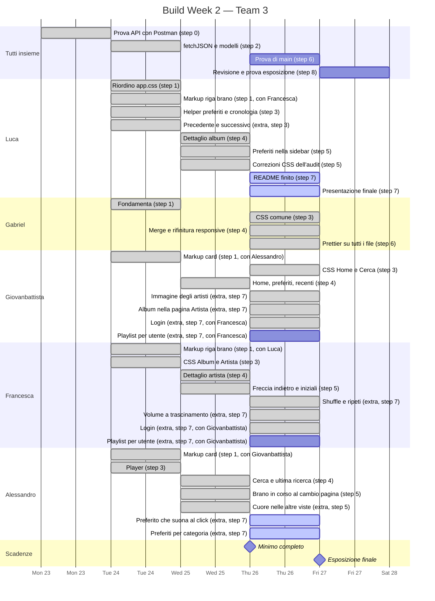
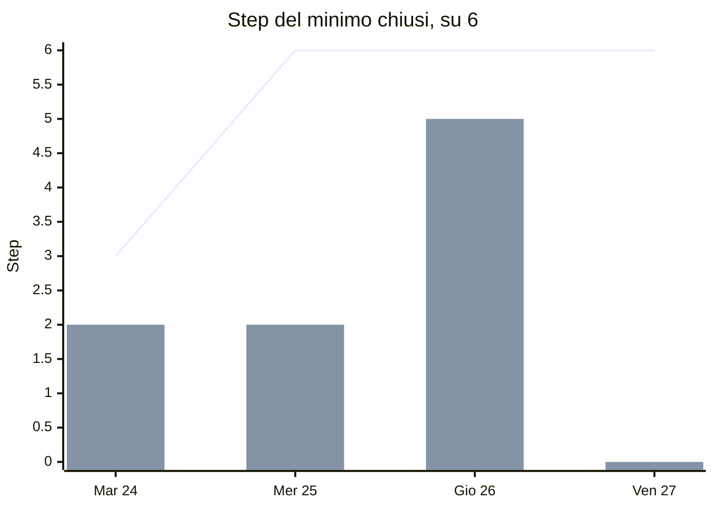
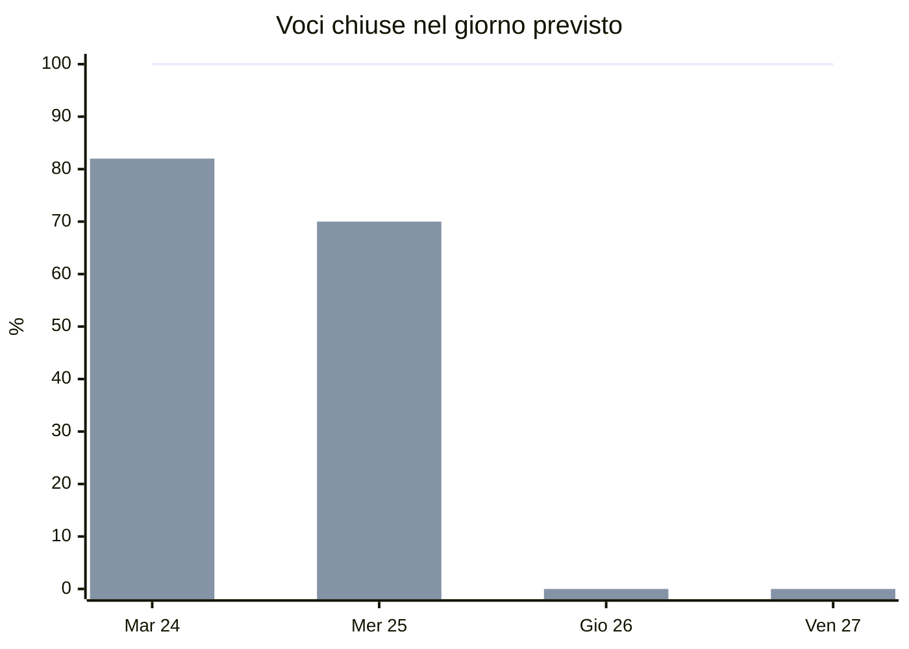
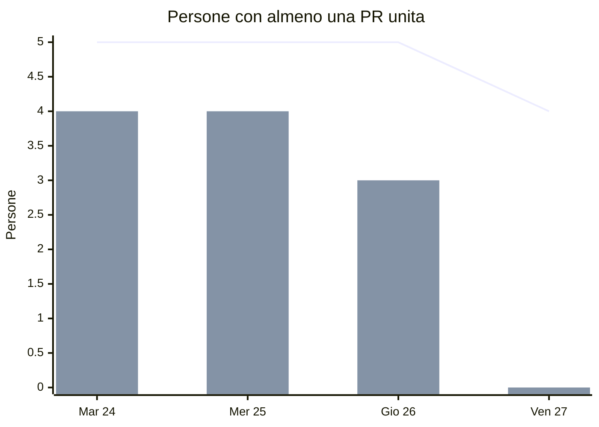
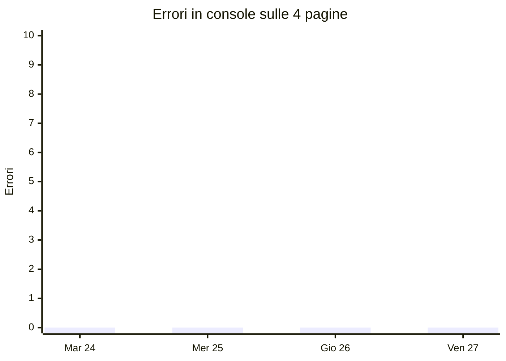
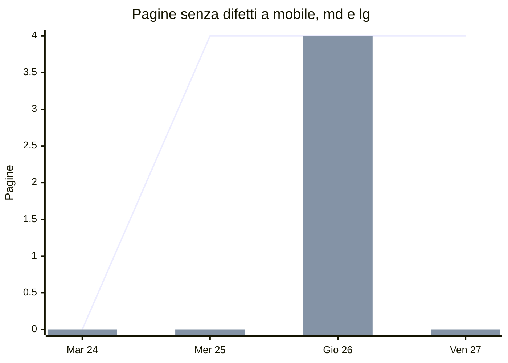
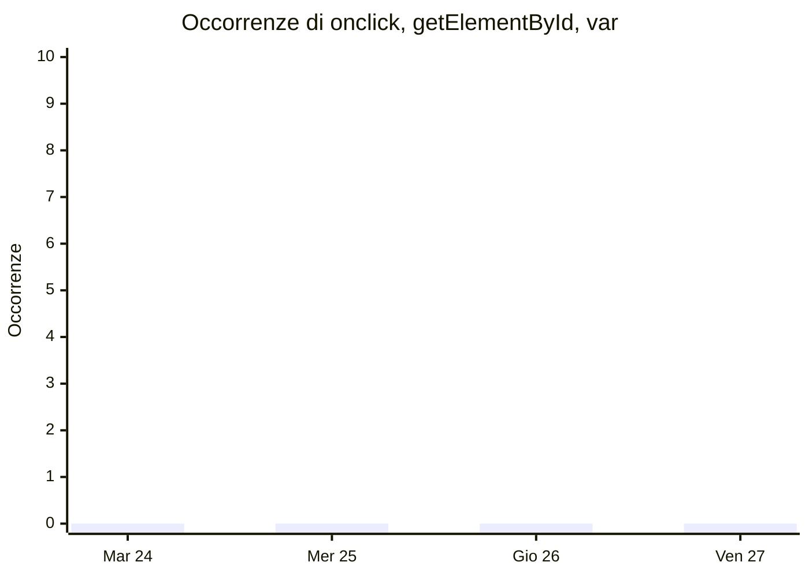

# Controllo e monitoraggio

Strumenti per seguire l'avanzamento della Build Week. Chi fa cosa e lo stato di ogni voce stanno nel *Backlog* di [Project management](Project%20management.md); qui c'è il piano nel tempo.

## Gantt

Chi fa cosa e in quale giorno; tra parentesi lo step del backlog. Si aggiorna dopo lo stand-up quando un lavoro slitta. Le barre grigie (`done`) sono le voci a «Fatto» nel backlog, quelle evidenziate (`active`) le voci «In corso».

## KPI

Pochi indicatori, tutti misurabili in pochi minuti dopo lo stand-up. Li rileva il TL (venerdì chi coordina la giornata) e li segna nei grafici di *Andamento dei KPI*.

| # | KPI | Come si misura | Obiettivo |
| --- | --- | --- | --- |
| K1 | Avanzamento del minimo | Step da 1 a 6 chiusi nel backlog (tutte le loro voci a «Fatto»), su 6 | Martedì sera 3 (step 1–3); mercoledì sera 6 |
| K2 | Rispetto del Gantt | Voci chiuse nel giorno previsto, su quelle previste quel giorno | 100%; sotto l'80% si ripianifica allo stand-up |
| K3 | Integrazione su `main` | Pull request unite da Gabriel nel giorno, e persone con almeno una PR unita | Almeno una PR per chi ha scritto codice, ogni giorno |
| K4 | Errori in console | Errori nella console del browser aprendo le 4 pagine da `main` | 0 |
| K5 | Pagine responsive | Pagine provate senza difetti a mobile, `md` e `lg` | 4 su 4 da mercoledì sera |
| K6 | Vincoli sul codice | Occorrenze di `onclick`, `getElementById` e `var` nei file: `grep -rnE "onclick=\|getElementById\(\|\bvar " assets/js *.html` | 0 |

## Andamento dei KPI

Un grafico per KPI: le **barre** sono il valore reale, la **linea** l'obiettivo. Dopo lo stand-up si scrive il valore del giorno nell'array `bar`, nella posizione del giorno (martedì è il primo). I valori stanno solo qui.

### K1 — Avanzamento del minimo

### K2 — Rispetto del Gantt

### K3 — Integrazione su main

Venerdì l'obiettivo è 4 e non 5: Luca è assente.

### K4 — Errori in console

Obiettivo: 0, nessuna barra.

### K5 — Pagine responsive

### K6 — Vincoli sul codice

Obiettivo: 0, nessuna barra.
